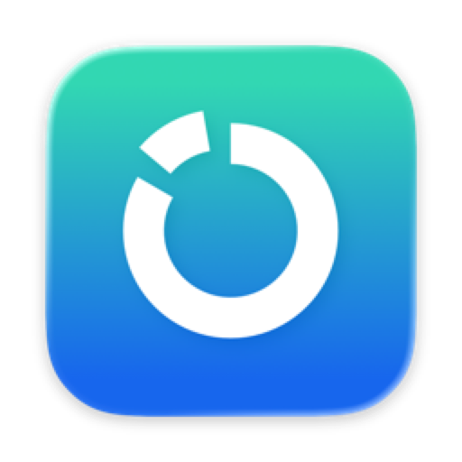
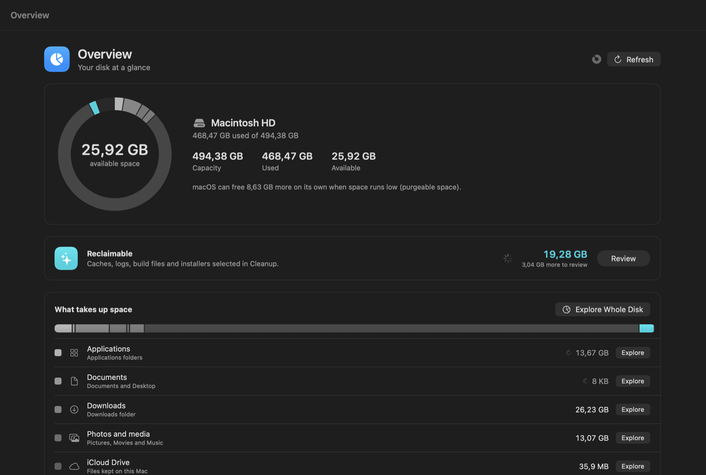
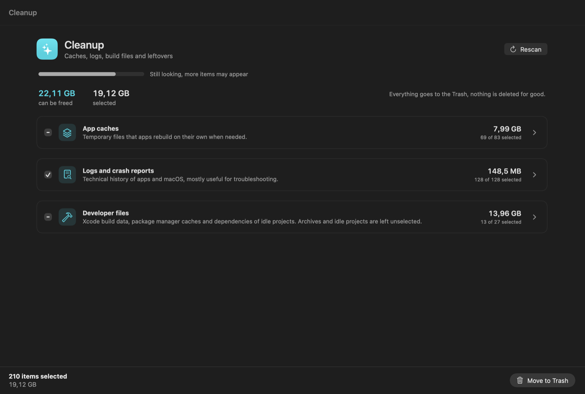
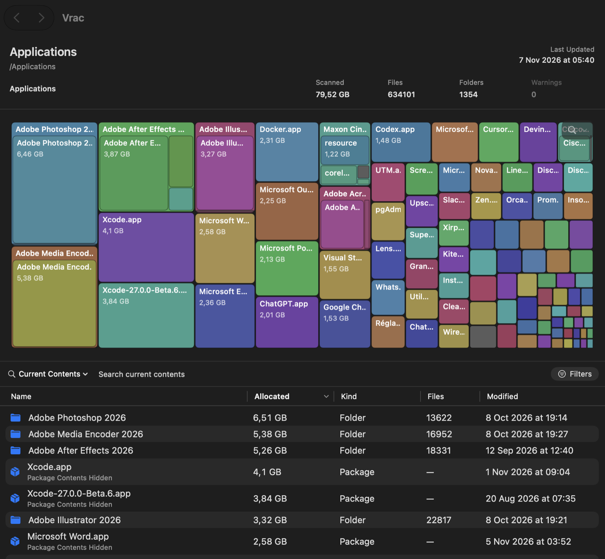
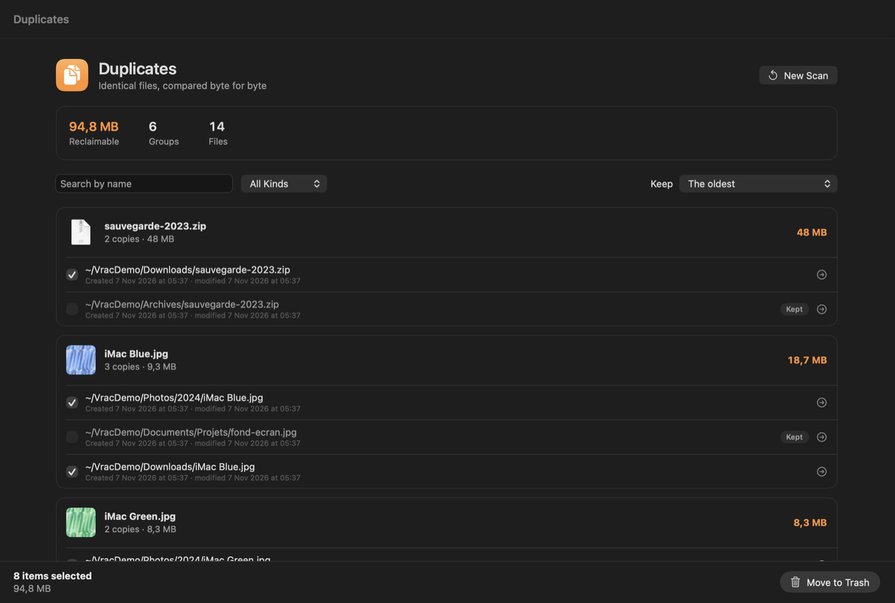
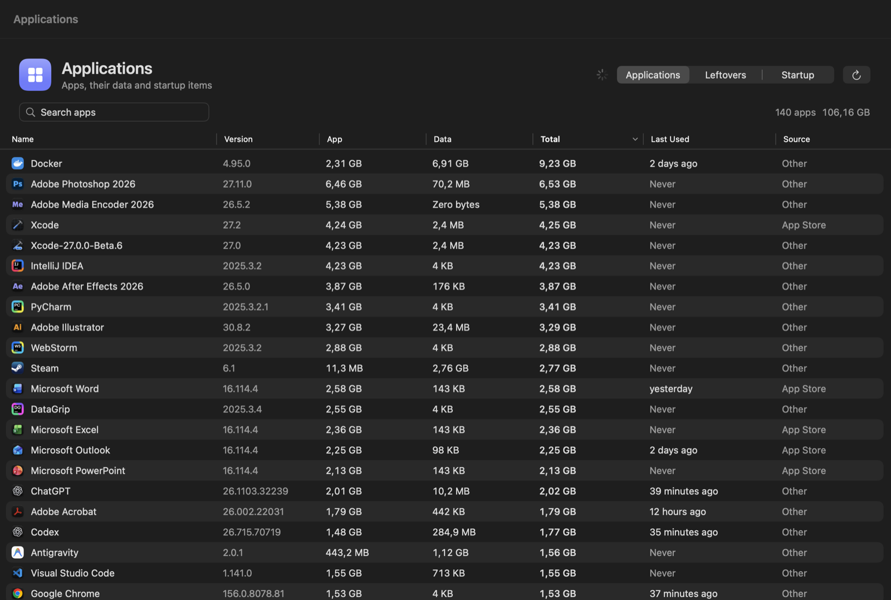
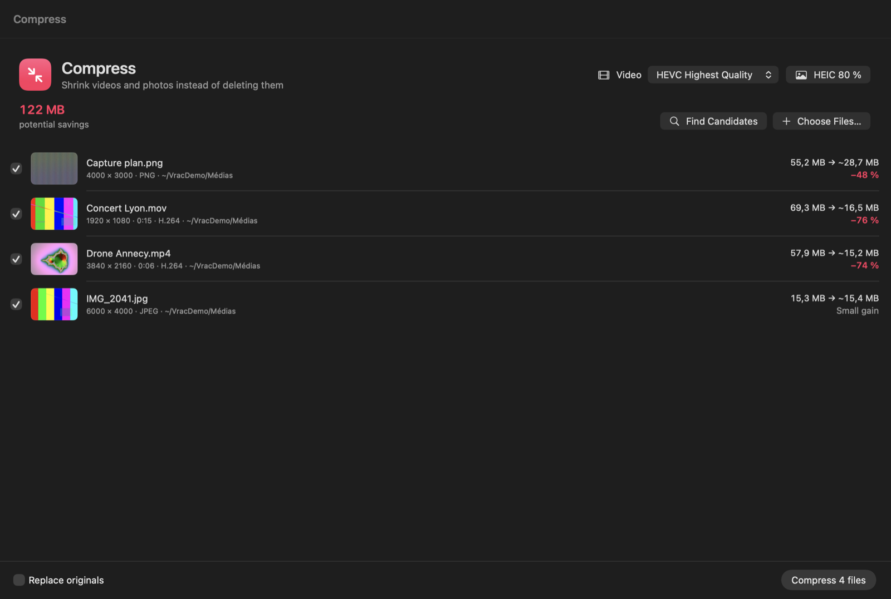
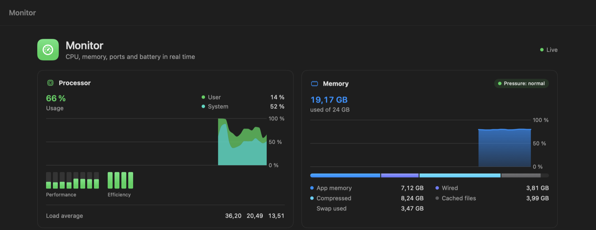

<div align="center">
  
  <h1>Vrac</h1>
  <p><strong>See where your Mac's storage went, and take it back safely.</strong></p>

  <p>
    <a href="https://github.com/thibautgnt/Vrac/releases/latest"></a>
    
    
    <a href="LICENSE"></a>
  </p>

  <p>
    <a href="https://github.com/thibautgnt/Vrac/releases/latest"><strong>Download</strong></a>
    ·
    <a href="#install">Install</a>
    ·
    <a href="#build-from-source">Build</a>
  </p>

  
</div>

## What Vrac does

Vrac is a native macOS app that maps your disk, finds what can go, and never deletes anything on its own:
everything you remove is reviewed first and goes to the Trash.

|     |     |
| --- | --- |
| **Overview** | The whole disk on one screen. What you keep is drawn in gray, what you can reclaim in color. |
| **Disk map** | Sunburst and treemap views of any folder or volume, with an inspector, search, scan snapshots and comparisons over time. |
| **Cleanup** | App caches, logs, Xcode and package-manager build files, old installers and downloads, grouped and totalled. Risky items start unchecked. |
| **Duplicates** | Identical files compared byte for byte. APFS clones and hard links are recognized, and one copy of every group is always kept. |
| **Applications** | Every app with its data in `~/Library`, complete uninstall, leftovers of apps already removed, and launch agents with an on/off switch. |
| **Compress** | Re-encode videos to HEVC and photos to HEIC instead of deleting them. Metadata and dates are preserved. |
| **Monitor** | CPU, memory, processes, listening ports, disk throughput and battery health in real time. |

Everything runs locally: no account, no analytics, no network calls.

## Screenshots

<table>
  <tr>
    <td width="50%"><p align="center"><sub>Cleanup: reclaimable space by category</sub></p></td>
    <td width="50%"><p align="center"><sub>Disk map: treemap of a folder</sub></p></td>
  </tr>
  <tr>
    <td width="50%"><p align="center"><sub>Duplicates: groups sorted by wasted space</sub></p></td>
    <td width="50%"><p align="center"><sub>Applications: sizes, data and uninstall</sub></p></td>
  </tr>
  <tr>
    <td width="50%"><p align="center"><sub>Compress: estimated savings before encoding</sub></p></td>
    <td width="50%"><p align="center"><sub>Monitor: live CPU and memory</sub></p></td>
  </tr>
</table>

## Install

1. Download `Vrac.zip` from the [latest release](https://github.com/thibautgnt/Vrac/releases/latest), unzip it and drag
   `Vrac.app` into **Applications**.
2. The app is not notarized by Apple. Once, in Terminal:
   ```bash
   xattr -cr /Applications/Vrac.app
   ```
   Or open the app, then **System Settings › Privacy & Security › Open Anyway**.
3. For a complete picture, grant **Full Disk Access** when Vrac asks for it. Without it, Vrac still works on every
   folder you can already open, and tells you what it had to skip.

The interface is in English and French.

## Safety

- Nothing is ever deleted permanently: items go to the Trash, so you can put them back until you empty it.
- Every removal goes through a selection you review and a confirmation.
- System locations are protected, and files are re-checked just before they are moved.
- Vrac never reaches inside packages such as a Photos library.

## Build from source

Requirements: macOS 14 or later, Xcode 26 or later (Swift 6.2).

```bash
make install   # Release build, signed, copied to /Applications
make test      # core test suite
```

`make install` signs with a local Apple Development certificate (`SIGN_IDENTITY=...` to use yours) so that macOS keeps
the Full Disk Access grant from one build to the next.

## Credits

Vrac is a fork of [Radix](https://github.com/colinvkim/Radix) by Colin Kim, released under the MIT license. Radix
provides the scan engine, the disk map, the inspector and scan comparisons; Vrac adds the overview, cleanup,
duplicates, applications, compress and monitor rooms. Type and project names still say Radix so upstream changes can
be merged.

## Developer documentation

<details>
<summary>View build instructions, project structure, and architecture</summary>

## Building from source

Clone the repository and run the Swift package tests:

```bash
git clone https://github.com/thibautgnt/Vrac.git
cd Vrac
swift test
```

Open `Radix.xcodeproj` in Xcode to build and run the complete app, or build it from the command line:

```bash
xcodebuild \
  -project Radix.xcodeproj \
  -scheme Radix \
  -configuration Debug \
  -destination 'platform=macOS' \
  build
```

The SwiftPM package contains `RadixCore` and its Swift Testing suite. The shared Xcode scheme runs the same core tests: use **Product → Test** (Cmd-U), or replace `build` with `test` in the command above.

## Project Structure

```text
Radix/
├── Radix/                    # App and core source code
│   ├── App/                  # App entry point, commands, and window management
│   ├── Models/               # Scan targets, node records, snapshots, and safety models
│   ├── Services/             # Scanning, archives, comparison, geometry, formatting, and room logic
│   ├── ViewModels/           # Application state and UI coordination
│   ├── Features/
│   │   ├── Rooms/            # Vrac rooms: Overview, Cleanup, Duplicates, Applications, Compress, Monitor
│   │   ├── Comparison/       # Scan comparison setup and results
│   │   ├── DiscardPile/      # Cleanup candidate review
│   │   ├── FileList/         # Sortable file browser
│   │   ├── Inspector/        # Single- and multiple-selection details and actions
│   │   ├── Onboarding/       # Welcome flow, permission guidance, and workspace tour
│   │   ├── Settings/         # Scan, visualization, and app preferences
│   │   ├── Sidebar/          # Smart Locations, recent scans, and Discard Pile
│   │   ├── Visualization/    # Sunburst and treemap views
│   │   └── Workspace/        # Main scanning and exploration interface
│   └── Shared/               # Reusable SwiftUI components and helpers
├── RadixCoreTests/           # Unit, integration, and benchmark-style tests
├── Package.swift             # RadixCore Swift package definition
└── Radix.xcodeproj/          # Complete macOS app project
```

## Architecture

- `ScanEngine` is an actor-based asynchronous scanner that uses iterative file-system traversal. `ScanCoordinator` owns scan state, while `IncrementalScanService` reuses prior results when it can safely reconcile filesystem changes.
- `AppModel` is the central `@MainActor` state and coordination layer for the application.
- `ScanSnapshot` and `FileTreeStore` represent scan results using flat tree storage and indexed lookups.
- Archive and comparison services stream, validate, and compare `.vracscan`
  snapshots. Format v5 losslessly compresses the large node and topology
  sections with LZFSE while retaining v3/v4 import compatibility.
- Sunburst and treemap services separate layout and interaction models from their SwiftUI presentation.
- Each room keeps its state in a shared `@MainActor` model, its non-UI logic in `Radix/Services/<Room>/` (part of `RadixCore`, with tests), and its strings in its own catalog. `RoomTrash` is the single path to the Trash for rooms. See `AGENTS.md`.
- `RadixCore` has no external Swift package dependencies. Sparkle is still linked but never started.

</details>

## License

MIT, see [LICENSE](LICENSE). Original work copyright Colin Kim (Radix).
